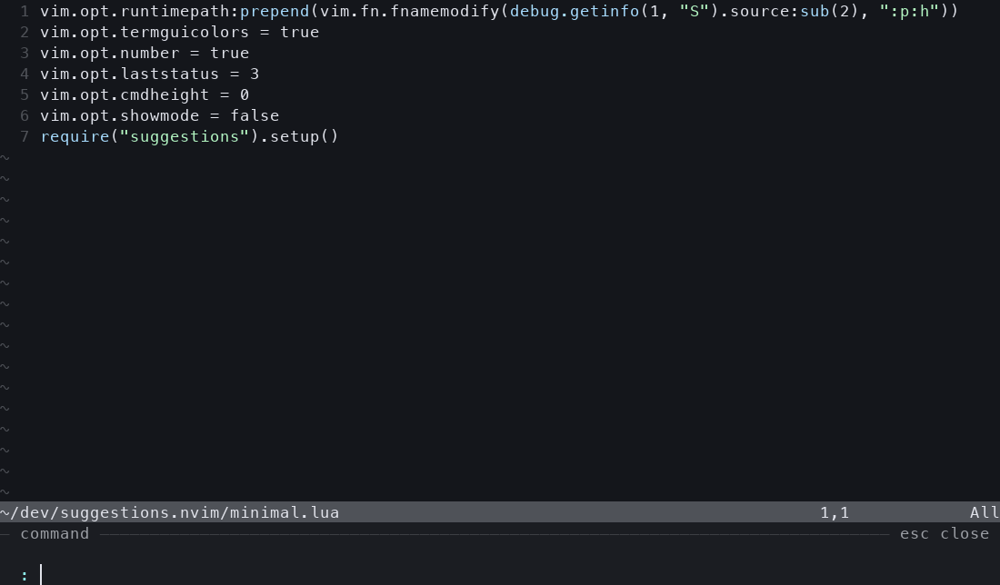

# suggestions.nvim

English | [简体中文](README.zh-CN.md)

Turn Neovim's command line into a minibuffer that expands from the bottom of the editor. Both ordinary Ex commands and `:!` get fish-style history suggestions; shell completion comes from a real **zsh / ZLE** session.



The drawer spans the editor width, has no outer frame, and adapts to your theme. Input stays on the bottom row while candidates expand upward. It reserves space with `cmdheight`, restores the layout on close, and uses the actual terminal cursor.

## Quick start

Requires **Neovim 0.11+ and zsh 5.8+** on macOS or Linux. The plugin has no third-party Lua, Python, or tmux runtime dependencies.

Install **fzf** to enable fuzzy completion (enabled by default). Without it, Ex completion falls back to Neovim and search suggestions are unavailable. Optional **fd** speeds up project file collection; otherwise the plugin uses `find`.

Try it from this repository:

```sh
nvim -u ./minimal.lua
```

Press `:` and type `!git st`, `!cd ~/`, or `!ls `. Ghost text prefers zsh history, then the first completion that extends your input. Press Right to accept it.

For Ex commands, try `:set nu` or `:edit al`. The most recent matching Neovim `:` history entry takes priority, followed by completion. Candidates that equal the input or rewrite its prefix are skipped for automatic ghost text. An explicit Tab selection takes priority.

Install with lazy.nvim:

```lua
{
  "arusuki/suggestions.nvim",
  lazy = false,
  opts = {},
}
```

For a local checkout, replace the repository string with `dir = vim.fn.expand("~/dev/suggestions.nvim")`. If installed under `pack/*/start` or already on `runtimepath`, call:

```lua
require("suggestions").setup()
```

## Interaction

| Key | Behavior |
| --- | --- |
| `→` | Accept an explicit selection or ghost text at the end of the line; otherwise move right |
| `Alt-f` | Accept one word of ghost text; otherwise move forward one word |
| `Alt-b` | Move backward one word |
| `Tab` / `Shift-Tab` | Cycle forward / backward through candidates |
| `↑` / `↓` | Browse prefix-matched zsh history; move through candidates after an explicit selection |
| `Enter` | Confirm an explicit selection; otherwise execute the current input |
| `Ctrl-a` / `Ctrl-e` | Move to the beginning / end; at the end, `Ctrl-e` accepts ghost text |
| `Ctrl-k` | Delete from the cursor to the end |
| `Ctrl-u` / `Ctrl-w` | Keep Neovim's native backward line / word deletion |
| `Esc` / `Ctrl-c` | Cancel the command and close the drawer |

Automatically displayed candidates are not preselected. Enter executes only the current input; unaccepted ghost text is never executed.

Ex commands use Neovim's native completion contexts, including files, options, Lua, and user commands. Neovim still handles `:%s`, visual ranges, search, register insertion, nested `Ctrl-r =` expressions, and execution. Search and other prompts use the drawer without requesting zsh completion.

Ghost text appears only at the end of a nonempty command, never in search or nested expression prompts. Ex history uses Neovim's loaded history, including ShaDa and the current session, respects `'history'` and native history deletion, and skips multiline entries. Without an explicit selection, Ex Up/Down retain native history navigation. With `completion.auto = false`, Ex history suggestions still appear; press Tab to request completion.

Shell completion supports `!cmd`, `2,4!cmd`, `read !cmd`, and `write !cmd`. Candidates preserve zsh's quoting, escaped spaces, directory slashes, and text to the right of the cursor. Completion uses the originating window's working directory, including `:lcd`.

## Configuration

### Fuzzy completion

The fzf backend follows the candidate collection → filtering approach of [wilder-fzf](https://github.com/arusuki/wilder.nvim/tree/master/wilder-fzf), integrated into the existing drawer and acceptance keys:

- Ex command names, options, buffers, help tags, colorschemes, compilers, filetypes, events, augroups, highlights, history types, packages, syntax names, environment variables, and users are collected before fuzzy matching. Try `:set rnu` → `relativenumber` or `:help usr41` → `usr_41.txt`. Custom callbacks, Lua/expression completion, and other unsupported contexts retain native behavior.
- File/directory completion searches recursively from the nearest `.git`/`.hg` root, falling back to the originating window's working directory. Paths are inserted relative to that window, including with `:lcd`. Try `:edit lsc` to find `lua/suggestions/completion.lua`. `fd` respects ignore files; the `find` fallback skips hidden entries but does not read ignore files. A query starting with `.` or containing `/.` includes hidden entries; `.git`/`.hg` are always excluded. Paths beginning with `~`, `/`, `\\`, `..`, `%`, `#`, `<`, or `$`, and wildcard/environment-variable paths use native completion.
- `/` and `?` collect complete, unique keywords from the current buffer using its `iskeyword`. `/dised` can match `distributed`, and `/ac` can match `a_b_c`. Matching uses smartcase; explicit `\c`/`\C` overrides it. Accepting a candidate inserts a literal `\V` search, preserving an explicit case modifier and the search direction. Search has no ghost text. Tab selects, Right or Enter accepts, and a subsequent Enter executes the search.

Matching and sorting run asynchronously through `fzf --filter`, using literal fuzzy queries (fzf's extended operators are disabled). `completion.max_results` applies **after** matching. User `FZF_DEFAULT_OPTS` and `FZF_DEFAULT_OPTS_FILE` do not affect the backend. New input, closing, reload, and disable cancel obsolete jobs; errors/timeouts retain native Ex candidates and appear in `inspect().current.error`.

Shell completion and prefix history suggestions continue to use zsh. Set `fuzzy.enabled = false` to restore native Ex completion without search suggestions, `fuzzy.files = false` to keep native file completion, or `fuzzy.search = false` to disable search suggestions.

### Options

```lua
require("suggestions").setup({
  enabled = true,
  ui = {
    max_height = 10,
    max_ratio = 0.35,  -- Also cap the drawer at 35% of screen height.
    min_height = 3,
    padding = 2,
    separator = "─",
  },
  completion = {
    auto = true,      -- false: request completion with Tab.
    debounce_ms = 70,
    max_results = 80,
  },
  fuzzy = {
    enabled = true,
    executable = "fzf", -- An absolute path also works.
    timeout_ms = 2000,   -- Per collection/filter process.
    files = true,
    search = true,
  },
  zsh = {
    shell = "zsh",    -- An absolute path also works.
    timeout_ms = 1800,
    startup_timeout_ms = 6000,
    history_limit = 3000,
    -- history_file = vim.fn.expand("~/.zsh_history"),
    -- env = { ZDOTDIR = vim.fn.expand("~/.config/zsh") },
  },
  keys = {
    accept = "<Right>",
    accept_word = "<M-f>",
    -- word_left = false, -- Disable an individual plugin mapping.
  },
})
```

The worker loads interactive zsh startup files, so your existing `compinit`, `compdef`, aliases, and `fpath` are available. If completion has not been initialized, it runs `compinit -i -D`. See the [zsh completion system documentation](https://zsh.sourceforge.io/Doc/Release/Completion-System.html) for these configuration mechanisms.

History comes from `history_file`, then the shell's `$HISTFILE`, then `~/.zsh_history`. It is read when the worker starts. Shell commands submitted in the current Neovim session stay in memory; the plugin does not rewrite your terminal history file.

**Completion and execution are separate.** Neovim still executes `:!` using [`shell` and `shellcmdflag`](https://neovim.io/doc/user/options.html#'shellcmdflag'). To load interactive zsh configuration for execution as well, for example to use aliases, configure:

```lua
vim.opt.shell = vim.fn.exepath("zsh")
vim.opt.shellcmdflag = "-ic"
```

Each `:!` is still a separate command execution, not a persistent terminal session. `!cd` does not change Neovim's directory. Use `:terminal` for interactive TUI programs.

Override these highlight groups to customize the appearance: `SuggestionsNormal`, `SuggestionsMuted`, `SuggestionsGhost`, `SuggestionsBorder`, `SuggestionsAccent`, and `SuggestionsSelection`. Defaults follow the current theme and refresh on `ColorScheme`.

## Commands and compatibility

- `:SuggestionsEnable` / `:SuggestionsDisable` / `:SuggestionsToggle`
- `:SuggestionsReload` — reread zsh configuration and disk history; Lua API: `require("suggestions").reload()`
- `:checkhealth suggestions`
- `:lua vim.print(require("suggestions").inspect())` — inspect UI state, backend errors, startup output, and pending requests

After editing `compdef`, aliases, `fpath`, or completion functions in `.zshrc`, run:

```vim
:SuggestionsReload
```

Reload immediately restarts the zsh worker while keeping plugin options, mappings, current input, and shell history from this Neovim session. It discards old completion requests and candidates. With automatic completion enabled, it completes the active input again. Reload does nothing while the plugin is disabled. Startup is asynchronous; inspect backend state for errors.

The worker is a separate interactive, non-login zsh. Following [zsh's startup rules](https://zsh.sourceforge.io/Doc/Release/Files.html), it normally reads `.zshenv` and `.zshrc`, respects `$ZDOTDIR`, and does not automatically read `.zprofile` or `.zlogin`. Functions and aliases defined only in another running terminal are not synchronized. The plugin owns the completion menu and key bindings, resets some shell options, and clears `precmd_functions`, `preexec_functions`, and `chpwd_functions`; terminal Tab behavior is not reproduced in every detail.

Use one command-line renderer at a time. Disable Noice's `cmdline` and any wilder or cmp-cmdline completion/rendering integration. Insert-mode completion is separate. Disabling suggestions.nvim restores overridden mappings and `cmdheight`, and stops the worker.

If zsh is missing or startup/completion times out, the drawer reports the backend as unavailable while Ex commands and native execution remain usable. The next request retries startup. Increase the relevant timeout for slow `.zshrc` files or completion functions.

Input is single-line and scrolls horizontally with the cursor. Completion descriptions and live history synchronization across terminals are not supported. Neovim's `vim.ui_attach` and `nvim__redraw` APIs are experimental; integration tests cover compatibility.

## Implementation and testing

Inspired by [terminal_mate.nvim's background zsh approach](https://github.com/beardnick/terminal_mate.nvim/blob/main/lua/terminal_mate/zsh_completion.lua), this plugin independently implements a backend and UI for Neovim's native command line:

- `vim.ui_attach(ext_cmdline)` handles display while native command-line mode retains input, parsing, and execution.
- A persistent PTY runs zsh with `vared` and a ZLE completion widget. Candidates are read from ZLE's actual insertion results rather than reconstructed shell tokens.
- Request text travels through NUL-delimited files in a private directory, not as PTY keystrokes or `eval` code. Completion functions can still run helper programs, as they do in a terminal.
- Debouncing, serialized requests, and generation checks prevent stale results from replacing current input. Timeouts, process exit, and disabling clean up the worker and temporary files.

```sh
python3 -m venv .venv
.venv/bin/pip install -r tests/requirements.txt
.venv/bin/python -m unittest discover -s tests -p integration.py -v
.venv/bin/python tests/preview.py
```

Tests require fzf and connect to real Neovim UI and zsh instances. They cover fuzzy Ex/search matching, recursive paths, case handling, filtering before limiting, missing/failed fzf, quoting, Unicode cursors, multiple candidates, custom completion, shell/Ex history suggestions, cancellation, stale requests, timeout recovery, configuration reload, layout, and screen cursor placement. `tests/preview.py` renders dark/light previews and a GIF from Neovim's actual `ext_linegrid` output.

## References and credits

- [terminal_mate.nvim](https://github.com/beardnick/terminal_mate.nvim) — inspiration for the background zsh completion approach; see the implementation link above.
- [Zsh startup files](https://zsh.sourceforge.io/Doc/Release/Files.html) — startup order and `ZDOTDIR`.
- [Zsh completion system](https://zsh.sourceforge.io/Doc/Release/Completion-System.html) — `compinit`, `compdef`, and `fpath`.
- [Neovim shell options](https://neovim.io/doc/user/options.html#'shellcmdflag') — command execution through `shell` / `shellcmdflag`.

[MIT License](LICENSE).
