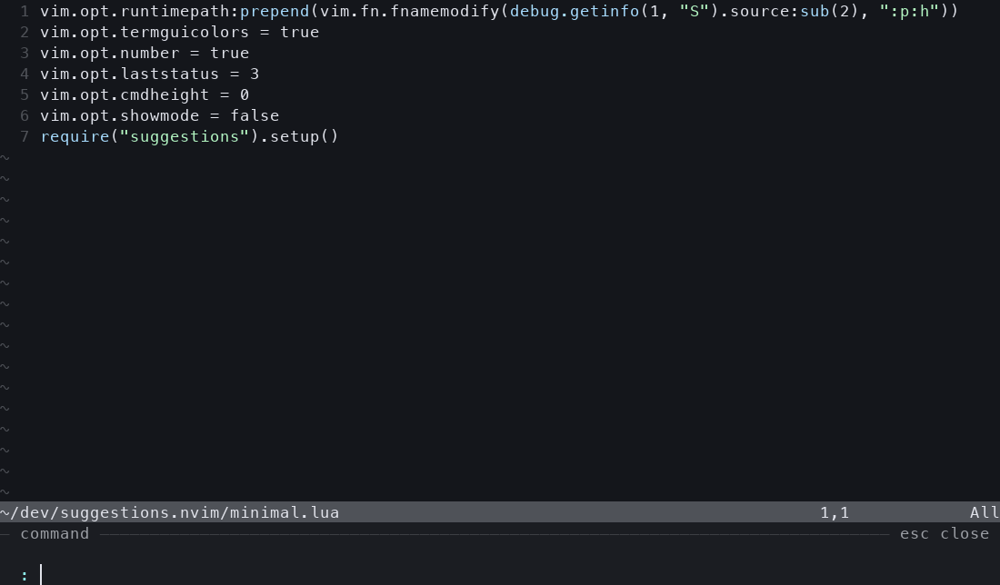

# suggestions.nvim

[English](README.md) | 简体中文

把 Neovim 命令行变成从编辑器底部展开的 minibuffer。普通 Ex 命令和 `:!` 都支持 fish 风格的历史灰字预测；输入 `:!` 时，由真正的 **zsh / ZLE** 提供补全。



全宽贴底、无外框、主题自适应；输入行固定在最底部，候选向上展开。面板通过 `cmdheight` 预留空间，编辑区随高度变化收缩，退出后恢复原布局。光标使用实际终端光标。

## 快速试用

需要 **Neovim 0.11+、zsh 5.8+**，适用于 macOS / Linux。插件运行时没有第三方 Lua、Python 或 tmux 依赖。

安装 **fzf** 后即可使用默认开启的模糊补全；未安装时，Ex 回退为 Neovim 原生补全，搜索候选不可用。可选安装 **fd** 加速项目文件收集，否则使用 `find`。

在这个项目目录运行：

```sh
nvim -u ./minimal.lua
```

按 `:`，输入 `!git st`、`!cd ~/` 或 `!ls `。灰字优先来自 zsh 历史，没有历史匹配时使用第一个可延伸当前输入的补全。按右方向键采纳。

普通命令也可试试 `:set nu` 或 `:edit al`：灰字优先使用 Neovim `:` 历史中最近一条能延伸当前输入的命令，否则使用第一条能延伸输入的补全。与输入相同或需要改写前文的候选会被跳过；Tab 显式选中后，以选中项为准。

使用 lazy.nvim 安装：

```lua
{
  "arusuki/suggestions.nvim",
  lazy = false,
  opts = {},
}
```

加载本地项目时，将仓库字符串换成 `dir = vim.fn.expand("~/dev/suggestions.nvim")`。直接安装到 `pack/*/start` 或已加入 `runtimepath` 时：

```lua
require("suggestions").setup()
```

## 交互

| 按键 | 行为 |
| --- | --- |
| `→` | 行末采纳灰字；有显式选中候选时采纳该项；否则移动光标 |
| `Alt-f` | 按词采纳灰字；否则向前移动一个词 |
| `Alt-b` | 向后移动一个词 |
| `Tab` / `Shift-Tab` | 选择下一个 / 上一个候选，循环选择 |
| `↑` / `↓` | 按输入前缀翻阅 zsh 历史；选中候选后改为移动选择 |
| `Enter` | 确认显式选中的候选；没有选择时执行当前输入 |
| `Ctrl-a` / `Ctrl-e` | 行首 / 行尾；行末有灰字时 `Ctrl-e` 采纳它 |
| `Ctrl-k` | 删除光标到行尾的内容 |
| `Ctrl-u` / `Ctrl-w` | Neovim 原生的向前删行 / 删词 |
| `Esc` / `Ctrl-c` | 取消命令，收起面板 |

自动出现的候选不会被预选。输入完整命令后，直接回车即可执行，未采纳的灰字不会被执行。

按 Enter 确认候选后，候选列表和灰字会收起，直到继续编辑输入（例如输入空格）才恢复。仅移动光标不会重新弹出补全。也可以按 Tab / Shift-Tab 主动请求候选；直接再按 Enter 则执行已确认的输入。

普通 Ex 命令使用 Neovim 原生补全上下文，包括文件、选项、Lua 和用户命令。`:%s`、可视选区范围、搜索、寄存器插入、`Ctrl-r =` 嵌套表达式和原生执行语义仍由 Neovim 处理。其他 input 提示默认只显示面板，可以通过 input 规则为指定提示启用补全。

灰字只在非空命令的行末显示，搜索和嵌套表达式提示不显示灰字。Ex 历史直接使用 Neovim 已加载的历史（含 ShaDa 和当前会话），遵循 `'history'` 设置和原生历史删除操作；多行历史不用于灰字。未选中候选时，Ex 的 `↑` / `↓` 保留原生历史导航。设置 `completion.auto = false` 后，Ex 历史灰字仍会显示，补全需按 Tab 请求。

`!cmd`、`2,4!cmd`、`read !cmd`、`write !cmd` 可使用 zsh 补全。候选保留 zsh 生成的引号、空格转义、目录斜杠和光标右侧文本；补全以发起命令的窗口工作目录为准，支持 `:lcd`。

## 配置

### 模糊补全

参照 [wilder-fzf](https://github.com/arusuki/wilder.nvim/tree/master/wilder-fzf) 的候选收集 → fzf 过滤方式，接入现有面板和确认按键：

- Ex 命令名、选项、buffer、帮助标签、配色、编译器、文件类型、事件、自动命令组、高亮组、历史类型、包、语法名、环境变量和用户名先收集候选，再交给 fzf 匹配。例如 `:set rnu` → `relativenumber`、`:help usr41` → `usr_41.txt`。自定义补全回调、Lua/表达式及其他未支持的上下文保留原生行为。
- 文件和目录从最近的 `.git` / `.hg` 项目根目录递归收集；没有项目标记则使用发起窗口的工作目录。插入路径相对于该窗口，支持 `:lcd`。例如 `:edit lsc` 可匹配 `lua/suggestions/completion.lua`。`fd` 遵循 ignore 文件；`find` 回退跳过隐藏项，但不读取 ignore 文件。查询以 `.` 开头或包含 `/.` 时包含隐藏项，始终排除 `.git` / `.hg`。以 `~`、`/`、`\\`、`..`、`%`、`#`、`<`、`$` 开头，以及含通配符或环境变量的路径交回原生补全。
- `/`、`?` 按当前 buffer 的 `iskeyword` 收集完整且去重的关键词。`/dised` 可匹配 `distributed`，`/ac` 可匹配 `a_b_c`。默认 smartcase，显式 `\c` / `\C` 覆盖大小写规则。采纳后插入 `\V` 字面搜索，保留显式大小写修饰符和搜索方向。搜索不显示灰字；Tab 选择，Right 或 Enter 采纳，再按 Enter 执行搜索。

匹配和排序通过异步 `fzf --filter` 完成，使用普通模糊查询，关闭 fzf 扩展运算符。同分时优先较短的候选，长度也相同时保留原始候选顺序。`completion.max_results` 在**匹配之后**应用。用户的 `FZF_DEFAULT_OPTS` 和 `FZF_DEFAULT_OPTS_FILE` 不影响后端。新输入、关闭、reload 和禁用会取消过期任务；错误或超时时保留原生 Ex 候选，可在 `inspect().current.error` 查看原因。

Shell 补全及前缀历史建议继续使用 zsh。设置 `fuzzy.enabled = false` 恢复原生 Ex 补全并关闭搜索候选；`fuzzy.files = false` 单独保留原生文件补全；`fuzzy.search = false` 单独关闭搜索候选。

### 选项

```lua
require("suggestions").setup({
  enabled = true,
  ui = {
    max_height = 10,
    max_ratio = 0.35,  -- 同时限制为屏幕高度的 35%
    min_height = 3,
    padding = 2,
    separator = "─",
  },
  completion = {
    auto = true,      -- false：按 Tab 后请求补全
    debounce_ms = 70,
    max_results = 80,
    empty = "none",   -- 空输入不提示；设为 "history" 时只显示历史
    history_limit = 10, -- 空输入最多展示的历史条数
  },
  input = {
    enabled = false, -- 是否为 input() 提供 suggestions 补全
    completion = "native",
    rules = {},
  },
  fuzzy = {
    enabled = true,
    executable = "fzf", -- 也可使用绝对路径
    timeout_ms = 2000,   -- 每个收集/过滤进程的超时
    files = true,
    search = true,
    highlight = true,    -- 高亮模糊候选中的匹配字符
  },
  zsh = {
    shell = "zsh",    -- 也可使用绝对路径
    timeout_ms = 1800,
    startup_timeout_ms = 6000,
    history_limit = 3000,
    -- history_file = vim.fn.expand("~/.zsh_history"),
    -- env = { ZDOTDIR = vim.fn.expand("~/.config/zsh") },
  },
  keys = {
    accept = "<Right>",
    accept_word = "<M-f>",
    -- word_left = false, -- false 禁用某个插件映射
  },
})
```

空输入（包括只有空白字符、`:!` 后尚未输入命令，以及启用补全的 input 提示）默认不显示候选或灰字，按 Tab 也不会请求普通补全。已经输入命令后的参数补全（如 `:edit `、`:!ls `）不受影响。

设置 `completion.empty = "history"` 后，空输入只显示最近的历史记录：Ex 使用 `:` 历史，`/` 和 `?` 使用搜索历史，shell 使用 zsh 和当前会话历史，其他已启用补全的 input 使用 Neovim 共享的 input 历史。候选按最近使用顺序去重，跳过空白和多行记录，最多显示 `completion.history_limit` 条（正整数，默认 10），同时受 `completion.max_results` 限制。没有历史时不显示候选，也不会回退为普通补全。空输入仍不显示灰字或自动选中历史；Tab 选择，Enter 确认后再次 Enter 才执行。`completion.auto = false` 时需按 Tab 请求历史候选；关闭搜索或 input 补全时也不显示其历史候选。`zsh.history_limit` 仍单独控制从磁盘加载的历史条数。

### Input 补全与 compile-mode.nvim

可以为 `vim.fn.input()` 和默认的 `vim.ui.input()` 单独配置是否启用补全，以及使用哪种补全。为 [compile-mode.nvim](https://github.com/ej-shafran/compile-mode.nvim) 提供命令补全，在 suggestions 配置中加入：

```lua
require("suggestions").setup({
  input = {
    rules = {
      {
        prompt = "^Compile command:",
        enabled = true,
        completion = "shell",
      },
    },
  },
})
```

该规则将输入直接作为 zsh 命令行补全，无需添加 `!`。它替代这个提示符原有的补全，即使 compile-mode 开启了 `input_word_completion` 也一样。命令名、别名、参数、路径和 shell 历史与 `:!` 共用后端；确认后仍由 compile-mode 接收并执行命令。

`input.enabled` 和 `input.completion` 是默认值。规则按顺序匹配，**第一条匹配的规则生效**，未指定的字段继承默认值。`prompt` 是针对显示提示符的 Lua 模式，包含空白字符。规则中的 `enabled = false` 关闭 suggestions 对该 input 的补全，让 Neovim 处理补全与编辑，抽屉仍然显示。

| `completion` | 行为 |
| --- | --- |
| `"native"` | 使用 input 声明的补全类型，包括 `custom` / `customlist` 回调；没有声明时不生成候选。 |
| `"shell"` | 将整个输入视为 zsh 命令行，提供补全和 shell 历史建议。 |
| `"file"`、`"dir"`、`"command"` 等 | 为整个输入值指定 Neovim 补全类型；`command` 表示 Ex 命令名。 |
| `"custom,Function"` / `"customlist,Function"` | 调用 Vimscript 或 `v:lua.Function` 补全函数，传入查询文本、完整输入和按字节计算的光标位置。 |

Input 补全共用 `completion.auto`、`debounce_ms`、`max_results` 及现有选择/接受按键，不使用 fzf。`auto = false` 时按 Tab 请求候选。已有选中候选时，Enter 先接受候选，再按 Enter 提交；没有选择时直接提交当前文本。Esc 取消。确认的 shell 输入加入会话历史，取消的输入不加入。原生 input 候选也可显示灰字建议，但不会使用 Ex 历史。

规则适用于原生命令行输入。如果其他插件将 `vim.ui.input` 替换成浮动 buffer，该输入由那个插件管理，suggestions.nvim 无法为其提供补全。

默认读取交互式 zsh 的启动配置，所以已有 `compinit`、`compdef`、aliases 和 `fpath` 可直接使用。没有初始化补全时，后端使用 `compinit -i -D` 初始化。历史路径优先取 `history_file`，否则使用 zsh 配置里的 `$HISTFILE`，最后回退到 `~/.zsh_history`。历史在后端启动时加载，当前 Neovim 会话中提交的 shell 命令追加到内存；不会改写终端历史文件。

补全后端与执行后端分开：**`:!` 仍由 Neovim 原生执行，使用 `&shell` 和 `&shellcmdflag`**。如果希望执行也加载同一份交互式 zsh 配置，例如使用 aliases，可在自己的配置中设置：

```lua
vim.opt.shell = vim.fn.exepath("zsh")
vim.opt.shellcmdflag = "-ic"
```

这仍是 `:!` 的一次性命令执行，不是持久化终端会话；`!cd` 不改变 Neovim 的目录。交互式 TUI 程序使用 `:terminal`。

可覆盖以下高亮组：`SuggestionsNormal`、`SuggestionsMuted`、`SuggestionsGhost`、`SuggestionsBorder`、`SuggestionsAccent`、`SuggestionsSelection`。默认配色取自当前主题，并在 `ColorScheme` 后重新适配。

Shell 输入（`:!`、过滤命令及配置为 shell 补全的 input 提示）的提示符和顶部分隔线默认使用柔和的淡粉色。颜色会混合当前主题的前景与背景；浅色主题使用更深的玫瑰色保持可读性，切换主题后自动重新适配。通过 `highlights.shell` 可同时配置这两处的颜色及其他 `nvim_set_hl` 属性，设置后会在切换主题时保留：

```lua
require("suggestions").setup({
  highlights = {
    shell = { fg = "#d4abbd" }, -- 自定义粉色；留空 {} 则跟随主题自动调和
  },
})
```

未配置 `highlights.shell` 时，也可通过 `vim.api.nvim_set_hl` 分别覆盖 `SuggestionsShellAccent`（提示符）与 `SuggestionsShellBorder`（顶部分隔线）。

模糊匹配字符使用 `SuggestionsMatch` 和 `SuggestionsSelectedMatch`，分别对应普通候选和选中候选。默认使用主题强调色并加粗，保留选中行的背景色。可以通过 setup 配置颜色及其他 `nvim_set_hl` 属性，切换主题后会重新应用：

```lua
require("suggestions").setup({
  highlights = {
    match = { fg = "#f4468f", bold = true },
    selected_match = { fg = "#ffd166", bold = true, underline = true },
  },
})
```

未设置上述选项时，也可直接通过 `vim.api.nvim_set_hl` 覆盖这两个高亮组。设置 `fuzzy.highlight = false` 只关闭字符高亮，不改变补全行为。

匹配位置计算改编自 [wilder-fzf 的 Lua 高亮实现](https://github.com/arusuki/wilder.nvim/blob/master/wilder-fzf/lua/wilder_fzf/highlighter.lua)：使用 fzf v2 风格的边界/连续匹配评分和回溯，超长输入回退到 v1。例如 `linear` 会高亮 `line/linear.py` 中 `/` 后的连续匹配。高亮与过滤共享实际查询和大小写模式，支持 UTF-8 字节位置，并在截断省略号之前停止。筛选和排序仍由 fzf 完成；与参考实现一样，仅用于显示的位置计算未实现 fzf 的重音字符归一化。

## 管理与兼容

- `:SuggestionsEnable` / `:SuggestionsDisable` / `:SuggestionsToggle`
- `:SuggestionsReload` 重新读取 zsh 配置和磁盘历史；Lua API：`require("suggestions").reload()`
- `:checkhealth suggestions`
- `:lua vim.print(require("suggestions").inspect())` 查看当前状态、后端错误和请求状态

修改 `.zshrc` 中的 `compdef`、aliases、`fpath` 或补全函数后，执行：

```vim
:SuggestionsReload
```

该命令立即重启后台 zsh，保留插件配置、按键映射、当前输入和本次 Neovim 会话中的 shell 历史；旧补全请求及候选会被清除。开启自动补全时，会重新补全当前输入。插件处于禁用状态时，此命令不启动后端。启动是异步的，失败信息可通过 `inspect()` 查看。

后端是独立的交互式、非登录 zsh，遵循 [zsh 启动文件规则](https://zsh.sourceforge.io/Doc/Release/Files.html)：默认读取 `.zshenv` 和 `.zshrc`，支持 `$ZDOTDIR`，不会主动读取 `.zprofile` 或 `.zlogin`。其他终端里临时定义的函数和 aliases 不会同步。插件接管补全菜单与按键，重置部分 shell 选项，并清空 `precmd_functions`、`preexec_functions`、`chpwd_functions`，因此不保证与终端 Tab 的所有行为完全一致。

不要同时启用多个命令行渲染器。使用 Noice 时关闭其 `cmdline`；使用 wilder 或 cmp-cmdline 时关闭它们的命令行补全 / 渲染。普通 Insert 模式的补全插件不受影响。关闭插件会恢复被覆盖的命令行映射及 `cmdheight`，并结束后台 zsh。

zsh 缺失、启动超时或补全超时时，面板会显示后端不可用，Ex 命令和原生执行仍可使用。下次请求会重启后端。耗时的 `.zshrc` 或补全函数可通过对应 timeout 选项调整。

界面是单行命令输入，长输入随光标水平滚动。暂不显示 zsh 候选的描述列，也不做跨终端实时历史同步。Neovim 的 `vim.ui_attach` 和 `nvim__redraw` 仍属于实验 API；兼容性由集成测试覆盖。

## 实现与验证

参考 [terminal_mate.nvim 的后台 zsh 思路](https://github.com/beardnick/terminal_mate.nvim/blob/main/lua/terminal_mate/zsh_completion.lua)，这里独立实现了面向原生命令行的后端与 UI：

- `vim.ui_attach(ext_cmdline)` 接管显示，输入、解析和执行仍保留在原生 command-line mode。
- 持久 PTY 中的 zsh 使用 `vared` 和 ZLE completion widget 运行真实补全；逐项读取 ZLE 插入结果，而非重新拼接 shell token。
- 命令文本通过私有目录内的 NUL 分隔文件传递，不作为 PTY 按键或 `eval` 代码发送。补全函数本身仍会像终端补全一样运行其所需的程序。
- 防抖、请求串行化和版本校验避免旧结果覆盖新输入；超时、退出及禁用会清理进程和临时文件。

```sh
python3 -m venv .venv
.venv/bin/pip install -r requirements-dev.txt
.venv/bin/pre-commit install --install-hooks
.venv/bin/python -m unittest discover -s tests -p integration.py -v
.venv/bin/python tests/preview.py
```

本地提交 hook 使用 StyLua 格式化已暂存的 Lua 文件，使用 Ruff 格式化 Python 文件，分别遵循 `stylua.toml` 和 `ruff.toml`。格式化工具版本固定在 `.pre-commit-config.yaml` 中。如果格式化修改了文件，检查后重新暂存，再次提交即可。手动格式化整个仓库可运行 `.venv/bin/pre-commit run --all-files`。

测试连接真实 Neovim UI 和真实 zsh，覆盖路径引号、中文光标、多个候选、自定义补全、shell / Ex 历史灰字、补全兜底、取消、过期请求、超时恢复、配置重载、布局及屏幕光标。`tests/preview.py` 从 Neovim 实际 `ext_linegrid` 输出生成暗色 / 亮色预览与 GIF。

## 参考与致谢

- [terminal_mate.nvim](https://github.com/beardnick/terminal_mate.nvim)：后台 zsh 补全方案的灵感来源，具体参考实现见上文。
- [zsh 启动文件](https://zsh.sourceforge.io/Doc/Release/Files.html)：配置文件的加载顺序和 `ZDOTDIR`。
- [zsh 补全系统](https://zsh.sourceforge.io/Doc/Release/Completion-System.html)：`compinit`、`compdef` 和 `fpath`。
- [Neovim shell 选项](https://neovim.io/doc/user/options.html#'shellcmdflag')：命令执行使用的 `shell` / `shellcmdflag`。

[MIT License](LICENSE).
